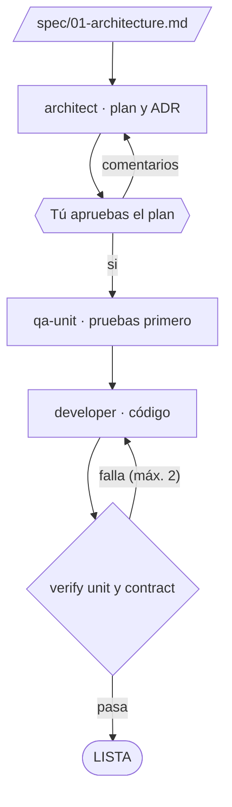

Certificado · Next-Gen Coding: Desarrollo de Software con IA Generativa (Virtual)

**Módulo 4 · Agentes en producción · Manual de práctica**

# Agentes en producción · Sesión 1 · Arquitectura

La fábrica construye el producto

Una fábrica de agentes de Claude Code construye el HR Assistant, lo prueba, lo revisa y lo publica. Tú diriges, apruebas y compruebas.

**CONTENIDO**

1. Cómo usar esta guía

2. Requisitos para todo el módulo

3. Sesión 1 · La fábrica, desde una carpeta vacía

4. Estructura final de la carpeta

5. Resumen de los pasos

6. Si algo falla

7. Lista de comprobación

## Cómo usar esta guía

En este módulo construyes, con tus manos, una **fábrica de agentes** de Claude Code. Después la fábrica construye sola el producto (el HR Assistant), lo prueba, lo revisa contra `QA.md` y, en la sesión 4, lo publica cuando tú lo apruebas. Tú no escribes el producto: escribes los agentes, el orquestador, los hooks y las verificaciones que lo construyen.

Es **incremental**: la sesión 1 parte de una carpeta vacía; cada sesión copia la carpeta anterior y le agrega piezas. Lo que construyas hoy es el punto de partida de la siguiente sesión.

| Concepto | Detalle |
|---|---|
| Sesión | 1 de 4 · Arquitectura |
| Hoy | La fábrica, desde una carpeta vacía |
| Patrón de la fábrica | Razonamiento: plan y ejecución, con reflexión |
| Duración | 2 h 30 min, con tiempos pesimistas |
| Carpeta | `` |

Cada paso tiene tres partes:

- **Escribe:** el archivo completo, con su ruta; tu editor crea las carpetas al guardar. **Reemplaza** quiere decir que el archivo ya existe y cambia: pega la versión nueva completa encima de la anterior.

- **Ejecuta:** el comando para probar ese paso, para macOS / Linux y para Windows.

- **Observa:** lo que debe salir y la idea que deja.

> **CUIDADO**
>
> **Copia el código del archivo Markdown, no del PDF.** Junto con este PDF recibes `M4_sesion01.md`, con el mismo contenido. Al copiar de un PDF, los visores pierden la sangría, y en Python la sangría es parte del código. Lee en el PDF y copia del `.md` (ábrelo en tu editor).

No avances hasta que el paso anterior funcione. Casi todo se prueba sin el modelo (hooks y verificaciones son Python normal); solo los pasos con «Sí» en la columna «Llama al modelo» (resumen al final) gastan cuota de tu suscripción de Claude Code.

## Requisitos para todo el módulo

Este capítulo es igual en todos los manuales del módulo. Reúne **todo** lo que necesitas para las cuatro sesiones: cuentas, programas y datos que vas a sacar de cada cuenta. Resuélvelo **antes de la primera sesión**: si algo falta, la sesión se va en instalar y no en dirigir la fábrica.

| Sesión | Tema | Patrón de la fábrica | Cuenta que se usa por primera vez |
|---|---|---|---|
| 1 | Arquitectura | Razonamiento: plan y ejecución | GitHub y Claude Code |
| 2 | Observabilidad | Flujo: compuertas y evaluador-optimizador | LangSmith (opcional) |
| 3 | Costos | Multiagente: supervisor y paralelo | Cloudflare |
| 4 | Producción | Humano en el lazo y triage | Render |

Las cuentas de GitHub, Cloudflare, LangSmith y Render son **gratuitas** y no pidieron tarjeta al preparar el curso (noviembre de 2026). **Claude Code** es la excepción: necesita un plan **Pro o Max**, porque es el motor de la fábrica. No hace falta una clave de la API de Anthropic.

### Equipo

- Una computadora con **Windows 10 u 11**, **macOS** o **Linux**, con permiso para instalar programas.

- Conexión a internet: los agentes trabajan en la nube de Anthropic.

- Un navegador actualizado (Chrome, Edge, Firefox o Safari).

### Programas obligatorios

| Programa | Para qué | Comprobación |
|---|---|---|
| Git | Guardar versiones y publicar el producto | `git --version` |
| uv | Instalar Python 3.12 y las dependencias; correr todo con `uv run` | `uv --version` |
| Python 3.12 (lo instala uv) | El lenguaje de la fábrica y del producto | `uv run --python 3.12 python -- version` |
| GitHub CLI (`gh`) | Publicar el producto en tu repositorio (sesión 4) | `gh --version` |
| Claude Code | El motor de la fábrica: sus agentes, skills y hooks | `claude --version` |
| Un editor de código | Leer lo que escriben los agentes (sugerido: VS Code) | Abre la carpeta |

**Instalar Git**

**macOS / Linux**

```bash
# macOS (abre el instalador de herramientas de Apple)
xcode-select --install
# Linux (Debian / Ubuntu)
sudo apt install git
```

**Windows (PowerShell)**

```powershell
winget install --id Git.Git -e
```

**Instalar uv y Python 3.12**

**macOS / Linux**

```bash
curl -LsSf https://astral.sh/uv/install.sh | sh
uv python install 3.12
```

**Windows (PowerShell)**

```powershell
powershell -ExecutionPolicy ByPass -c "irm https://astral.sh/uv/install.ps1 | iex"
uv python install 3.12
```

Cierra y vuelve a abrir la terminal después de instalar uv. En todo el módulo usamos `uv run ...`: así no importa qué `python` traiga tu sistema. En macOS, `python3` suele ser la versión 3.9 de Apple y **no sirve**. No actives otros entornos virtuales en la misma terminal: `uv run` usaría ese y no el de la sesión.

**Instalar GitHub CLI e iniciar sesión**

**macOS / Linux**

```bash
# macOS (con Homebrew)
brew install gh
# Linux: sigue https://github.com/cli/cli#installation
gh auth login
```

**Windows (PowerShell)**

```powershell
winget install --id GitHub.cli -e
gh auth login
```

En `gh auth login` elige **GitHub.com**, **HTTPS** y **Login with a web browser**. Comprueba con `gh auth status`.

**Instalar Claude Code e iniciar sesión con tu plan**

**macOS / Linux**

```bash
curl -fsSL https://claude.ai/install.sh | bash
claude auth login
```

**Windows (PowerShell)**

```powershell
irm https://claude.ai/install.ps1 | iex
claude auth login
```

Si tienes la variable `ANTHROPIC_API_KEY` definida, quítala antes de `claude auth login`: Claude Code la usaría en lugar de tu suscripción y te cobraría por uso.

**macOS / Linux**

```bash
unset ANTHROPIC_API_KEY
```

**Windows (PowerShell)**

```powershell
Remove-Item Env:ANTHROPIC_API_KEY -ErrorAction SilentlyContinue
```

### Programas opcionales

| Programa | Para qué | Por qué es opcional |
|---|---|---|
| Docker Desktop | Probar el contenedor de la sesión 4 en tu máquina | Render y GitHub Actions construyen el contenedor en la nube |
| Un gestor de contraseñas | Guardar las claves que vas a generar | Muy recomendado: las claves no van en notas, chats ni capturas |

### Cuentas

Para cada cuenta, la tabla dice qué dato sacas y si es **secreto**. Un dato secreto nunca se pega en un chat (tampoco en el de Claude Code), un ticket, una captura de pantalla ni un comando: va en el archivo `.env` de tu máquina o en el panel de Render.

| Cuenta | Sesión | Dato que sacas | ¿Secreto? |
|---|---|---|---|
| Claude | 1 | Plan Pro o Max; `claude auth login` hecho | No |
| GitHub | 1 | Tu usuario y `gh auth login` hecho | No |
| LangSmith | 2 | API key de tipo *Tracing Only* (opcional) | **Sí** |
| Cloudflare | 3 | Account ID | No |
|  | 3 | API token de Workers AI | **Sí** |
|  | 3 | Nombre del AI Gateway: `default` | No |
| Render | 4 | Cuenta creada **con GitHub** | No |

**GitHub**

1. Crea la cuenta en github.com (plan Free) y confirma tu correo.

2. Instala GitHub CLI y corre `gh auth login` (arriba).

En la sesión 4 la fábrica publica el producto en **tu propio** repositorio privado; ahí corre el pipeline de CI y de ahí lo toma Render.

**LangSmith (trazas del producto, opcional)**

1. Crea la cuenta en smith.langchain.com (plan Developer, gratuito).

2. Ve a **Settings > API Keys > Create API Key** y elige el tipo **Tracing Only**: solo puede *escribir* trazas. Si tu cuenta no lo muestra, usa **Personal Access Token**.

3. Copia la clave **en tu gestor de contraseñas**. Por lo general solo se muestra una vez.

**Cloudflare (el modelo real del producto)**

1. Crea la cuenta en dash.cloudflare.com (plan Free) y confirma tu correo. No necesitas un dominio.

2. En el menú izquierdo entra a **AI > Workers AI** y elige **Use REST API**.

3. Copia el **Account ID**: 32 caracteres de números y letras de la `a` a la `f`. **No es tu correo.** También aparece en la URL: `dash.cloudflare.com/<ACCOUNT_ID>/...`.

4. Pulsa **Create a Workers AI API Token** y crea el token. Guárdalo en tu gestor de contraseñas: es secreto y solo se muestra una vez.

5. Entra a **AI > AI Gateway**. Debe existir un gateway llamado `default`; si no, pulsa **Create Gateway** y nómbralo `default`.

El plan gratuito da **10,000 neuronas al día** (se reinician a las 00:00 UTC). Al terminarse, las llamadas fallan; no se cobran. La fábrica prueba con el modelo simulado, así que casi no gasta cuota.

**Render (publicar el producto)**

1. Entra a render.com y elige **Sign up with GitHub**. Así Render puede leer tus repositorios.

2. Elige el plan **Free** (Hobby). No pidió tarjeta al preparar el curso.

El plan gratuito **duerme** el servicio tras 15 minutos sin uso: la primera petición después tarda cerca de un minuto. Es normal.

### Tu carpeta de trabajo

No clonas nada: construyes la fábrica tú, desde una carpeta vacía llamada `NextGenCode-M4-Agentes`, con una subcarpeta por sesión (`sesion01` a `sesion04`). El paso 0 de la sesión 1 la crea. Cada sesión copia la anterior y le agrega piezas; el producto lo construyen los agentes en `product/`.

### Confía en la carpeta (una vez)

La primera vez que abres `claude` en tu carpeta de trabajo, pregunta **«Do you trust the files in this folder?»**. Responde que sí. Sin esa confianza, Claude Code ignora los permisos de `.claude/settings.json` y los agentes no pueden correr las verificaciones. Hazlo en una terminal normal, no con un comando que corra `claude` sin pantalla.

### Lista de comprobación

Corre esto en una terminal nueva. Todo debe responder sin error.

```text
git --version
uv --version
uv run --python 3.12 python --version
gh --version
gh auth status
claude --version
```

- [ ] Git, uv, Python 3.12 y Claude Code responden
- [ ] `gh auth status` dice que entraste a github.com
- [ ] `claude auth login` hecho con mi plan Pro o Max
- [ ] Cloudflare: Account ID y token guardados; existe el gateway `default`
- [ ] Render: cuenta creada con GitHub

## Sesión 1 · La fábrica, desde una carpeta vacía

Hoy partes de una carpeta vacía y terminas con una fábrica de tres agentes que construye la primera versión del HR Assistant: una API **sin estado**, un **agente con tope de pasos**, un **modelo simulado** y una **página web** para el personal de RH. Un hook no deja que ningún agente se salga de su papel, y un programa (no un agente) decide si cada paso terminó bien.



### Paso 0 · El proyecto vacío y su entorno (10 min)

**Ejecuta**

**macOS / Linux**

```bash
mkdir -p NextGenCode-M4-Agentes/sesion01
cd NextGenCode-M4-Agentes
git init
cd sesion01
```

**Windows (PowerShell)**

```powershell
mkdir NextGenCode-M4-Agentes\sesion01
cd NextGenCode-M4-Agentes
git init
cd sesion01
```

Lo que usa la fábrica y lo que puede usar el producto, en un solo entorno:

**Escribe** `../requirements.txt`

```text
# Lo que usa la fábrica (hooks, verificación) y lo que puede usar el producto.
# El producto no instala nada por su cuenta: todo vive en este mismo entorno.
fastapi>=0.115
uvicorn>=0.30
pydantic>=2.7
httpx>=0.27
pytest>=8
pytest-bdd>=7
pytest-cov>=5
pylint>=3
```

Lo que generan los agentes no se versiona:

**Escribe** `.gitignore`

```text
# Lo que generan los agentes en cada corrida
product/
output/

# Entornos y secretos
.venv/
.env
__pycache__/
*.pyc
.pytest_cache/
.coverage
htmlcov/
.DS_Store
```

**Ejecuta**

**Todos los sistemas**

```bash
uv venv --python 3.12
uv pip install -r requirements.txt
```

**Observa:** se crea `.venv`. Los hooks y las verificaciones corren con `uv run`, que usa ese entorno.

### Paso 1 · Las reglas y la especificación (15 min)

Las reglas de calidad del curso. Los agentes las leen y una verificación las hace cumplir:

**Escribe** `QA.md`

````markdown
# Quality Assurance Policies

## Development Language Policy

All development activities within this project must be conducted in **English**:

- **Code**: All variable names, function names, class names, comments, and documentation
- **Commit messages**: All git commit messages must be in English
- **Pull request descriptions**: Titles and descriptions must be in English
- **Test names and descriptions**: All test cases and their descriptions must be in English
- **Documentation**: All README files, technical documentation, and API docs must be in English
- **Issue tracking**: Bug reports, feature requests, and discussion must be in English

## Code Quality Standards

### Testing Requirements
- Follow Test-Driven Development (TDD) practices
- Implement Behavior-Driven Development (BDD) using Gherkin scenarios
- All tests must pass before merging
- Maintain minimum 80% code coverage
- Write unit tests for all business logic
- **Unit Tests for Generated Code**: When generating or modifying code, create corresponding unit tests if necessary depending on:
  - Code complexity (functions with business logic)
  - Public API methods and classes
  - Critical functionality that could break
  - Code that handles edge cases or error conditions
  - Integration points between modules

### Code Style
- Follow language-specific style guides
- Use meaningful, descriptive names in English
- Keep functions small and focused
- Implement proper error handling
- No hardcoded values; use configuration where appropriate

#### Python Code Standards
- **PEP8 Compliance**: All Python code must comply with PEP8 style guidelines
- **Pylint**: Code must pass pylint checks with minimal warnings
- **Line Length**: Maximum 88 characters per line (Black formatter standard)
- **Import Organization**: Follow PEP8 import ordering (standard library, third-party, local)
- **No Emojis**: Code must not contain emojis in comments, strings, or documentation
- **Naming Conventions**: - Functions and variables: `snake_case`
  - Classes: `PascalCase`
  - Constants: `UPPER_SNAKE_CASE`
  - Private methods/attributes: prefix with underscore `_method_name`

### Architecture Constraints
- Maintain existing architecture patterns
- Follow established ADRs (Architecture Decision Records)
- Implement dependency injection for testability
- Ensure deterministic behavior (no direct datetime.now() usage)
- Maintain idempotency for batch operations

### Security
- Never commit secrets, keys, or sensitive information
- Follow security best practices
- Validate all inputs
- Use secure defaults

### Documentation
- Document all public APIs
- Maintain up-to-date README
- Document architectural decisions
- Include setup and running instructions

#### Documentation Organization
- **Root Level**: Only `README.md` and `QA.md` files are allowed in project root
- **doc/ Directory**: All other markdown documentation files must be placed in the `doc/` directory
- **File Naming**: Use descriptive, lowercase names with hyphens (e.g., `api-reference.md`, `deployment-guide.md`)

#### README Maintenance Policy
- **Update Requirement**: When making significant changes to the codebase, update `README.md` if necessary for better understanding
- **Content to Update**:
  - New features or functionality added
  - Changes to installation or setup procedures
  - Modified usage examples or API changes
  - New dependencies or requirements
  - Updated project structure or architecture
- **Guidelines**: Only update README when changes would genuinely help users understand or use the project better

#### Code Documentation Format
All code documentation must follow **Sphinx format** with this structure:

```python
"""Brief description of the function.

Detailed description if needed (optional).

:param param_name: Description of parameter
:type param_name: type
:param param_name2: Description of second parameter
:type param_name2: type
:return: Description of return value
:rtype: return_type
:raises ExceptionType: Description of when this exception is raised
"""
```

**Example:**
```python
def normalize_token(token):
    """Normalize a raw token.

    - Lowercases
    - Strips leading/trailing non-alphanumeric characters

    :param token: Raw token to normalize
    :type token: str
    :return: Normalized token (empty if no alphanumeric chars found)
    :rtype: str
    """
```

## Delivery Standards

Every implementation must include:
1. List of created/modified files
2. Brief implementation explanation
3. Instructions for running tests
4. Verification that all tests pass

### Code Verification Requirements
**Before completing any code request, ensure:**

1. **Functionality Verification**: Run and test the new code to confirm it works as expected
2. **Regression Testing**: Execute existing tests to ensure no previously working code was broken
3. **Integration Testing**: Verify that new code integrates properly with existing codebase
4. **Error Handling**: Test edge cases and error conditions
5. **Code Quality Checks**: Run linting tools (pylint, PEP8) to ensure code quality
6. **Documentation Verification**: Ensure all new code is properly documented with Sphinx format

### Verification Checklist
- [ ] New functionality works correctly
- [ ] All existing tests still pass
- [ ] New tests (if created) pass
- [ ] Code follows PEP8/pylint standards
- [ ] No breaking changes introduced
- [ ] Proper error handling implemented
- [ ] Documentation is complete and accurate

## Review Process

- All code must be reviewed before merging
- Tests must pass in CI/CD pipeline
- Code must follow established conventions
- No breaking changes without proper migration strategy
````

La especificación dice **qué** debe hacer el producto, no **cómo**. Es el contrato con la fábrica:

**Escribe** `spec/01-architecture.md`

````markdown
# Sesión 1 · Arquitectura simple y lista para crecer

Producto: **HR Assistant**, un asistente de Recursos Humanos que responde preguntas sobre empleados.
El personal de RH lo usa desde una página web.

## Lo que debe hacer

1. Una API web (FastAPI) **sin estado**: no guarda nada entre peticiones. Escalar es correr más copias.
2. Un **solo agente** con dos herramientas de solo lectura sobre `data/employees.json`:
   - `get_employee(employee_id)`: un empleado por id, por ejemplo `EMP-0004`. Si no existe, lo dice.
   - `search_by_department(department)`: los empleados de un departamento.
3. El agente trabaja en un **bucle con tope**: en cada vuelta el modelo pide una herramienta o responde.
   Si llega al tope sin responder, contesta exactamente:
   `No pude completar la respuesta. Intenta con una pregunta más concreta.`
4. El modelo se usa a través de una **interfaz** (`complete(messages)`), para poder cambiarlo sin tocar el agente.
   En esta sesión solo existe el **modelo simulado**.
5. Una **página web** para el personal de RH.

## Protocolo entre el agente y el modelo

El modelo responde siempre un único objeto JSON:

- `{"tool": "<nombre>", "args": {...}}` para pedir una herramienta.
- `{"answer": "<respuesta en español>"}` para responder.

El agente agrega el resultado de la herramienta a la conversación como un mensaje `user` que empieza con
`Resultado de la herramienta: ` y vuelve a preguntar al modelo.

## Modelo simulado (`MODEL_PROVIDER=fake`)

Determinista, sin red ni costo. Decide con reglas sobre el último mensaje:

1. Si empieza con `Resultado de la herramienta: ` → `{"answer": "Según el directorio: <resultado>"}`.
2. Si contiene un id con forma `EMP-` y cuatro dígitos → pide `get_employee` con ese id.
3. Si menciona un departamento que existe en los datos → pide `search_by_department`.
4. Si no → `{"answer": "Pregúntame por un empleado (EMP-0001) o un departamento."}`.

Cuenta tokens de forma aproximada: tokens de entrada = palabras de todos los mensajes; de salida = palabras de su respuesta.

## API
| Método y ruta | Qué hace |
| --- | --- |
| `GET /` | La página web |
| `GET /health` | `{"status": "ok", "pid": <id del proceso>}` |
| `POST /ask` | Cuerpo `{"question": "...", "history": [{"role": "user" o "assistant", "content": "..."}]}`. `history` es opcional |

Respuesta de `POST /ask`: `{"answer", "steps", "tools_used", "input_tokens", "output_tokens"}`.

- `question` vacía o con más de `MAX_QUESTION_CHARS` caracteres → `422`.
- El historial lo manda el cliente. La API no lo guarda.

## Configuración (variables de entorno, con valores por omisión)

| Variable | Por omisión | Para qué |
| --- | --- | --- |
| `MODEL_PROVIDER` | `fake` | Qué modelo usar. En esta sesión solo `fake` |
| `AGENT_MAX_STEPS` | `3` | Tope de vueltas del bucle |
| `MAX_QUESTION_CHARS` | `2000` | Largo máximo de la pregunta |
| `EMPLOYEES_PATH` | `data/employees.json` | Los datos |

Un valor inválido (por ejemplo `AGENT_MAX_STEPS=0`) impide arrancar, con un mensaje claro.

## Página web (`app/static/index.html`)

- Un solo archivo HTML con CSS y JavaScript adentro, sin librerías ni compilación. Se sirve en `GET /`.
- Campo de pregunta `data-testid="question"`, botón `data-testid="send"`, y la conversación `data-testid="answer"`.
- Cada respuesta muestra el texto y las herramientas usadas.
- El navegador guarda el historial de la conversación y lo manda en `history`.
- El texto de las respuestas se pinta con `textContent`, **nunca** con `innerHTML`: así una respuesta no puede inyectar código.
- Si la API responde un error, se muestra un mensaje en español.

## Estructura del producto

```
product/
  app/            main.py (expone `app` y `create_app()`), agent.py, llm.py, directory.py, config.py, static/index.html
  data/           employees.json (copia de spec/employees.json)
  tests/          pruebas unitarias y escenarios Gherkin (los escribe qa-unit)
  doc/            architecture.md y adr/ (los escribe architect)
  requirements.txt
```

- `create_app()` recibe sus dependencias (configuración, modelo, directorio) para que las pruebas inyecten las suyas.
- Solo se usan las librerías de `requirements.txt` de la fábrica: fastapi, uvicorn, pydantic, httpx, pytest, pytest-bdd y pytest-cov.
- No lleva `pyproject.toml`.

## Reglas de QA.md que aplican desde ya

- Nombres de código, pruebas y mensajes de la API en inglés. Comentarios y docstrings en español, con docstrings
  estilo Sphinx (`:param:`, `:return:`) en clases y funciones públicas.
- Líneas de máximo 88 caracteres. Sin emojis.
- Sin `datetime.now()` directo: si hace falta la hora, se inyecta.
- Pruebas: escenarios Gherkin (pytest-bdd) para el comportamiento y pruebas unitarias para la lógica. Cobertura de 80 % o más.
- Decisiones de arquitectura en ADR (`doc/adr/NNNN-titulo.md`).

## Cómo se comprueba

- `uv run python -m verification unit`: las pruebas del producto pasan con cobertura de 80 % o más.
- `uv run python -m verification contract`: las pruebas de contrato de la fábrica pasan contra el producto corriendo.
````

Los datos del directorio de empleados:

**Escribe** `spec/employees.json`

```json
[
  {
    "id": "EMP-0001",
    "name": "Ana López",
    "department": "Tecnología",
    "role": "Analista de datos",
    "start_date": "2019-03-04",
    "status": "activo"
  },
  {
    "id": "EMP-0002",
    "name": "Luis Pérez",
    "department": "Ventas",
    "role": "Ejecutivo de cuenta",
    "start_date": "2021-07-19",
    "status": "activo"
  },
  {
    "id": "EMP-0003",
    "name": "Marta Ruiz",
    "department": "Tecnología",
    "role": "Desarrolladora",
    "start_date": "2016-11-02",
    "status": "baja"
  },
  {
    "id": "EMP-0004",
    "name": "Jorge Díaz",
    "department": "Tecnología",
    "role": "Líder técnico",
    "start_date": "2022-01-10",
    "status": "activo"
  },
  {
    "id": "EMP-0005",
    "name": "Sofía Gómez",
    "department": "Finanzas",
    "role": "Contadora",
    "start_date": "2020-05-25",
    "status": "activo"
  }
]
```

> **ESPECIFICACIÓN, NO CÓDIGO**
>
> Si la especificación dictara el código, el arquitecto no tendría nada que planear ni tú nada que revisar. Describe comportamiento, configuración y cómo se comprueba.

### Paso 2 · Claude Code y la memoria del proyecto (10 min)

Claude Code lee este archivo al abrir la carpeta: son las reglas de la fábrica.

**Escribe** `CLAUDE.md`

```markdown
# Fábrica del HR Assistant (Módulo 4, sesión 1)

Los agentes construyen el producto en `product/` a partir de la especificación de `spec/`. Las personas dirigen,
aprueban y comprueban: no programan.

- `/factory` corre la fábrica completa.
- `.claude/agents/`: architect, qa-unit, developer.
- `hooks/permissions.py`: cada agente escribe solo en sus carpetas.
- `verification/`: el código decide si un paso terminó bien, no el agente.

## Reglas

- El orquestador delega: nunca escribe en `product/` (corrige al agente, no su resultado).
- Todo bucle tiene tope: 2 rechazos del plan y 2 correcciones; después se escala a una persona.
- Una persona aprueba el plan antes de que se escriba código.
- Nunca leas `.env`.
- Código en inglés; comentarios, docstrings, documentos y mensajes a las personas en español. Sin emojis.
  Es una excepción acordada a QA.md, que pide todo en inglés: no la reportes como incumplimiento.
```

**Ejecuta**

**Todos los sistemas**

```bash
claude
```

**Observa:** la primera vez pregunta **«Do you trust the files in this folder?»**: responde que sí y sal con `/exit`. Sin esa confianza, Claude Code ignora los permisos del proyecto y los agentes no pueden correr las verificaciones.

### Paso 3 · Los tres agentes (15 min)

Un agente es un archivo Markdown: arriba, entre `---`, su nombre, cuándo usarlo y sus herramientas; abajo, sus instrucciones.

El arquitecto planea; no programa:

**Escribe** `.claude/agents/architect.md`

```markdown
---
name: architect
description: >-
  Lee la especificación de spec/ y escribe el plan (output/plan.md) y los ADR
  del producto. No escribe código. Úsalo al inicio de la fábrica o cuando una
  persona comente el plan.
tools: Read, Glob, Grep, Write
---
Eres el arquitecto del HR Assistant. Planeas; no programas.

1. Lee todos los archivos de `spec/` y, si ya existe, lo que hay en `product/`.
2. Escribe `output/plan.md` con estas secciones, breves:
   - **Módulos**: cada archivo de `product/app/` y su responsabilidad en una línea.
   - **Flujo de una pregunta**: de la página web a la respuesta, en pasos numerados.
   - **Pruebas**: qué escenarios Gherkin y qué pruebas unitarias hacen falta.
   - **Riesgos**: lo que podría salir mal y cómo se evita.
3. Escribe **máximo 3 ADR nuevos por sesión** en `product/doc/adr/` (`0001-stateless-api.md`, etc.), solo las decisiones más
   importantes, cada uno con Contexto, Decisión y Consecuencias en pocas líneas. Escribe también `product/doc/architecture.md`, con un diagrama Mermaid.
4. Si te pasan comentarios de una persona, ajusta el plan y los ADR, y di qué cambiaste.

Escribe en español y sin emojis. Solo puedes escribir en `output/` y `product/doc/`; en `output/` solo va
`plan.md`, ningún otro archivo.
Termina con un resumen de cinco líneas del plan.
```

El ingeniero de QA escribe las pruebas **antes** que el código (TDD y BDD):

**Escribe** `.claude/agents/qa-unit.md`

```markdown
---
name: qa-unit
description: >-
  Escribe las pruebas del producto ANTES del código (TDD), con escenarios
  Gherkin (pytest-bdd) y pruebas unitarias en product/tests/. Úsalo después de
  que una persona aprueba el plan.
tools: Read, Glob, Grep, Write, Edit, Bash
---
Eres el ingeniero de QA de pruebas unitarias. Escribes las pruebas antes de que exista el código.

1. Lee `spec/`, `output/plan.md` y `QA.md`.
2. Escribe en `product/tests/`:
   - `features/*.feature`: escenarios Gherkin en inglés del comportamiento que pide la especificación.
   - `test_*_steps.py`: los pasos de esos escenarios con pytest-bdd.
   - `test_*.py`: pruebas unitarias de la lógica (agente, modelo simulado, configuración, directorio, API).
   - `conftest.py` si hace falta. Usa `create_app()` con dependencias inyectadas y `fastapi.testclient.TestClient`.
3. **Entre 15 y 25 pruebas nuevas por sesión**, contando los escenarios: un alumno debe poder leerlas en clase. Prefiere
   pocas pruebas claras que cubran cada requisito a muchas parecidas. Los nombres de las pruebas se leen como frases en inglés (`test_unknown_employee_is_reported`).
   Cubre los casos de error, no solo el camino feliz. Pide la cobertura de 80 % o más a través de lo que pruebas,
   no con trucos.
4. Puedes correr `uv run python -m verification unit` para ver que las pruebas se recolectan. Al principio
   **deben fallar**, porque el código todavía no existe: eso es lo esperado.

Escribe sin emojis. Solo puedes escribir en `product/tests/`; el código lo escribe otro agente.
Termina con la lista de archivos y cuántas pruebas escribiste.

En Bash solo puedes correr `uv run python -m verification <paso>`; para leer usa Read, Glob y Grep (nunca
`cat`, `grep` ni `cd` en Bash).
```

El desarrollador implementa el plan hasta que las pruebas pasan, sin tocarlas:

**Escribe** `.claude/agents/developer.md`

```markdown
---
name: developer
description: >-
  Implementa el plan aprobado (output/plan.md) en product/app/ hasta que pasen
  las pruebas de product/tests/. No escribe pruebas. Úsalo después de qa-unit,
  o para corregir con el error que te pasen.
tools: Read, Glob, Grep, Write, Edit, Bash
---
Eres el desarrollador del HR Assistant.

1. Lee `spec/`, `output/plan.md`, los ADR en `product/doc/adr/`, las pruebas de `product/tests/` y `QA.md`.
2. Escribe el código en `product/app/`, copia `spec/employees.json` a `product/data/employees.json` y escribe
   `product/requirements.txt` (solo las librerías que permite la especificación).
3. Corre las pruebas con `uv run python -m verification unit` hasta que pasen.
4. Si una prueba te parece equivocada, **no la cambies** (no puedes): explícalo en tu resumen final.
5. Si te pasan un error de la verificación, corrige el código y vuelve a correr las pruebas.

Reglas: código en inglés, comentarios y docstrings en español (estilo Sphinx), líneas de máximo 88 caracteres,
sin emojis y sin `datetime.now()` directo. Solo puedes escribir en `product/app/`, `product/data/` y
`product/requirements.txt`. No arranques servidores que se queden corriendo.
Termina con la lista de archivos que creaste o cambiaste y el resultado de las pruebas.

En Bash solo puedes correr `uv run python -m verification <paso>`; para leer usa Read, Glob y Grep (nunca
`cat`, `grep` ni `cd` en Bash).
```

> **PATRÓN DE RAZONAMIENTO: PLAN Y EJECUCIÓN**
>
> Primero se planea sin tocar código; una persona aprueba; después otros agentes ejecutan el plan. Separar las fases deja corregir cuando corregir es barato.

### Paso 4 · El hook de permisos (15 min)

**Escribe** `hooks/__init__.py`

*Archivo vacío: marca la carpeta como paquete de Python.*

Claude Code corre este programa **antes** de cada herramienta. Si termina con código 2, la herramienta se bloquea y el agente lee el motivo:

**Escribe** `hooks/permissions.py`

```python
"""Hook PreToolUse: cada agente escribe solo en sus carpetas (mínima agencia).

Claude Code llama a este script antes de cada herramienta y le pasa por stdin un
JSON con ``agent_type`` (el agente), ``tool_name`` y ``tool_input``. Si el script
termina con código 2, la herramienta se bloquea y el agente lee el motivo.
"""

import json
import sys
from pathlib import Path

ROOT = Path(__file__).resolve().parent.parent

# Dónde puede escribir cada agente. Quien escribe el código no escribe sus pruebas.
WRITABLE = {
    "architect": ["output/", "product/doc/"],
    "qa-unit": ["product/tests/"],
    "developer": ["product/app/", "product/data/", "product/requirements.txt"],
}
WRITE_TOOLS = {"Write", "Edit", "MultiEdit", "NotebookEdit"}

def check(event: dict) -> str | None:
    """Devuelve el motivo del bloqueo, o ``None`` si la herramienta puede correr."""
    agent = event.get("agent_type")
    if agent not in WRITABLE or event.get("tool_name") not in WRITE_TOOLS:
        return None
    target = (ROOT / event.get("tool_input", {}).get("file_path", "")).resolve()
    path = target.relative_to(ROOT).as_posix() if target.is_relative_to(ROOT) else ""
    if any(path == allowed or path.startswith(allowed) for allowed in WRITABLE[agent]):
        return None
    allowed = ", ".join(WRITABLE[agent])
    return f"{agent} no puede escribir {path or target}. Solo puede en: {allowed}"

if __name__ == "__main__":
    REASON = check(json.load(sys.stdin))
    if REASON:
        print(REASON, file=sys.stderr)
    sys.exit(2 if REASON else 0)
```

Registra el hook y los comandos que se permiten sin preguntar:

**Escribe** `.claude/settings.json`

```json
{
  "permissions": {
    "deny": [
      "Read(./.env)",
      "Read(./**/.env)",
      "WebFetch",
      "WebSearch"
    ],
    "allow": [
      "Bash(uv run python -m verification *)"
    ]
  },
  "hooks": {
    "PreToolUse": [
      {
        "matcher": "Write|Edit|MultiEdit|NotebookEdit",
        "hooks": [
          {
            "type": "command",
            "command": "uv run python \"$CLAUDE_PROJECT_DIR/hooks/permissions.py\""
          }
        ]
      }
    ]
  }
}
```

**Ejecuta**

**macOS / Linux**

```bash
echo '{"agent_type": "developer", "tool_name": "Edit", "tool_input": {"file_path": "product/tests/test_main.py"}}' | uv run python hooks/permissions.py
echo "código: $?"
```

**Windows (PowerShell)**

```powershell
'{"agent_type": "developer", "tool_name": "Edit", "tool_input": {"file_path": "product/tests/test_main.py"}}' | uv run python hooks/permissions.py
"código: $LASTEXITCODE"
```

**Observa**

```text
código de salida 2
developer no puede escribir product/tests/test_main.py. Solo puede en: product/app/, product/data/, product/requirements.txt
```

**Observa:** el desarrollador no puede escribir pruebas. El hook no depende de que el modelo obedezca.

### Paso 5 · Las verificaciones: el código decide (15 min)

Ningún agente dice si su trabajo está bien. Lo dicen estas verificaciones con su código de salida: 0 pasa; cualquier otro valor regresa el trabajo.

**Escribe** `verification/__init__.py`

```python
"""Verificaciones de la fábrica: el código decide si un paso terminó bien."""
```

El corredor: `uv run python -m verification unit` o `contract`:

**Escribe** `verification/__main__.py`

```python
"""Corre una verificación del producto y termina con su código de salida.

Uso: ``uv run python -m verification unit`` o ``uv run python -m verification contract``

- ``unit``: las pruebas que escribió qa-unit, con cobertura de 80 % o más.
- ``contract``: las pruebas de la fábrica contra el producto corriendo.

Código 0: pasa. Cualquier otro: falla, y la salida dice por qué.
"""

import subprocess
import sys
from pathlib import Path

ROOT = Path(__file__).resolve().parent.parent
PRODUCT = ROOT / "product"
PYTEST = [sys.executable, "-m", "pytest", "-q", "-p", "no:cacheprovider"]
STEPS = {
    "unit": (PYTEST + ["tests", "--cov=app", "--cov-fail-under=80"], PRODUCT),
    "contract": (PYTEST + ["verification/contract"], ROOT),
}

def run(step: str) -> int:
    """Corre la verificación ``step`` e imprime ``[OK]`` o ``[FAIL]``."""
    if step not in STEPS:
        print(f"Uso: python -m verification {{{'|'.join(STEPS)}}}")
        return 2
    command, folder = STEPS[step]
    if not (PRODUCT / "app").is_dir():
        print(f"[FAIL] {step}: todavía no existe product/app/")
        return 1
    code = subprocess.run(command, cwd=folder, check=False).returncode
    print(f"[{'OK' if code == 0 else 'FAIL'}] {step}")
    return code

if __name__ == "__main__":
    sys.exit(run(sys.argv[1] if len(sys.argv) > 1 else ""))
```

Arranca el producto con el modelo simulado para probarlo por HTTP, como un cliente:

**Escribe** `verification/contract/conftest.py`

```python
"""Arranca el producto con el modelo simulado para probarlo por HTTP.

Las pruebas de contrato no importan el código del producto: le hablan como un
cliente, así que valen sin importar cómo lo haya escrito el agente.
"""

import os
import subprocess
import sys
import time
from contextlib import contextmanager
from pathlib import Path

import httpx
import pytest

PRODUCT = Path(__file__).resolve().parents[2] / "product"

@contextmanager
def running_product(port: int, **env: str):
    """Corre ``uvicorn app.main:app`` en ``port`` mientras dure el bloque."""
    settings = {**os.environ, "MODEL_PROVIDER": "fake", **env}
    command = [sys.executable, "-m", "uvicorn", "app.main:app", "--port", str(port)]
    server = subprocess.Popen(command, cwd=PRODUCT, env=settings)
    url = f"http://127.0.0.1:{port}"
    try:
        for _ in range(40):
            try:
                httpx.get(f"{url}/health", timeout=1)
                break
            except httpx.TransportError:
                time.sleep(0.25)
        yield httpx.Client(base_url=url, timeout=10)
    finally:
        server.terminate()
        server.wait(timeout=10)

@pytest.fixture(scope="session")
def api():
    """El producto con su configuración por omisión."""
    with running_product(8765) as client:
        yield client

@pytest.fixture(scope="session")
def api_one_step():
    """El producto con el bucle limitado a una sola vuelta."""
    with running_product(8766, AGENT_MAX_STEPS="1") as client:
        yield client
```

El contrato: pruebas cortas cuyos nombres se leen como frases. Ningún agente puede editarlas:

**Escribe** `verification/contract/test_contract.py`

```python
"""Contrato de la sesión 1: lo que el producto debe hacer, visto desde afuera."""

def ask(api, question, **extra):
    return api.post("/ask", json={"question": question, **extra})

def test_health_answers_ok(api):
    response = api.get("/health")
    assert response.status_code == 200
    assert response.json()["status"] == "ok"

def test_home_page_has_the_question_form(api):
    page = api.get("/").text
    for test_id in ("question", "send", "answer"):
        assert f'data-testid="{test_id}"' in page

def test_asking_for_an_employee_uses_get_employee(api):
    body = ask(api, "¿Quién es EMP-0004?").json()
    assert "Jorge Díaz" in body["answer"]
    assert body["tools_used"] == ["get_employee"]
    assert body["steps"] == 2

def test_asking_for_a_department_lists_its_people(api):
    body = ask(api, "¿Quiénes trabajan en Finanzas?").json()
    assert "Sofía Gómez" in body["answer"]
    assert body["tools_used"] == ["search_by_department"]

def test_unknown_employee_still_gets_an_answer(api):
    assert ask(api, "¿Quién es EMP-9999?").status_code == 200

def test_empty_question_is_rejected(api):
    assert ask(api, "").status_code == 422

def test_too_long_question_is_rejected(api):
    assert ask(api, "a" * 2001).status_code == 422

def test_history_comes_from_the_client(api):
    history = [{"role": "user", "content": "Hola"}]
    assert ask(api, "¿Quién es EMP-0004?", history=history).status_code == 200

def test_the_step_cap_stops_the_loop(api_one_step):
    body = ask(api_one_step, "¿Quién es EMP-0004?").json()
    assert body["steps"] == 1
    assert "No pude completar" in body["answer"]
```

**Ejecuta**

**Todos los sistemas**

```bash
uv run python -m verification unit
```

```text
[FAIL] unit: todavía no existe product/app/
```

**Observa:** falla porque aún no hay producto. Es lo esperado: la verificación ya sabe qué exigir.

### Paso 6 · El orquestador: /factory (10 min)

El orquestador delega cada paso en su agente y decide qué sigue solo con el código de salida de las verificaciones. Sus topes: 2 rechazos del plan y 2 correcciones:

**Escribe** `.claude/skills/factory/SKILL.md`

```markdown
---
description: >-
  La fábrica de la sesión 1 · arquitecto → aprobación humana → qa-unit
  (pruebas primero) → developer → verificación (máx. 2 correcciones) →
  reporte. Ejemplo /factory
argument-hint: "[--aprobar]"
disable-model-invocation: true
allowed-tools: Agent, Read, Write, AskUserQuestion, Bash(uv run python -m verification *)
---
Eres el ORQUESTADOR de la fábrica. No escribes planes, pruebas ni código: delegas cada paso en su agente
(herramienta Agent) y decides qué sigue SOLO con el código de salida de la verificación.

Entrada: $ARGUMENTS. Si trae `--aprobar`, la persona aprobó por adelantado: no preguntes en el paso 2.
Si no lo trae y no puedes preguntar (por ejemplo en `claude -p`), detente en el paso 2 y explica cómo seguir.

Lleva una bitácora: una línea por paso con lo que pasó.

1. **Plan.** Lanza `architect` con: «Planea el producto de spec/».
2. **Aprobación humana.** Muestra `output/plan.md` y pregunta: «¿Apruebas el plan? Escribe si o tus comentarios».
   Con comentarios, relanza `architect` con «Comentarios de la persona: <comentarios>» y vuelve a preguntar.
   Máximo 2 rechazos; al tercero → ESCALAR (paso 6).
3. **Pruebas primero (TDD).** Lanza `qa-unit` con: «Escribe las pruebas de spec/ y output/plan.md».
   Corre `uv run python -m verification unit`. Debe FALLAR, porque aún no hay código: anótalo como «rojo».
4. **Código.** Lanza `developer` con: «Implementa output/plan.md hasta que pasen product/tests/».
5. **Verificación con reflexión (máximo 2 correcciones).** Corre `uv run python -m verification unit` y después
   `uv run python -m verification contract`. Si una falla, relanza `developer` con
   «La verificación <unit o contract> falló; corrige esto: <últimas 40 líneas de la salida>» y verifica de nuevo.
   Si después de 2 correcciones sigue fallando → ESCALAR. Si las dos pasan → LISTA.
6. **Reporte.** Escribe `output/report.md` con el estado (LISTA, DETENIDA POR LA PERSONA o ESCALAR A UNA PERSONA),
   cuántas correcciones hubo y la bitácora. Si quedó LISTA, agrega cómo abrir la página:
   `cd product` y `uv run uvicorn app.main:app`, y luego http://127.0.0.1:8000. Responde con el mismo resumen.

Reglas: corre cada verificación sola y tal cual está escrita, sin `;`, `&&` ni `|`: su código de salida es el veredicto, y con `| tail` se pierde. Nunca edites tú los archivos de
`product/` (corrige al agente, no su resultado). Nunca te saltes un paso ni una verificación. No leas `.env`.
```

> **REFLEXIÓN CON TOPE**
>
> Si una verificación falla, el orquestador le devuelve al agente las últimas 40 líneas del error. Máximo dos veces; después decide una persona.

### Paso 7 · La lista de QA de la fábrica (10 min)

La fábrica también cumple `QA.md`: sus hooks y su corredor tienen pruebas.

**Escribe** `scripts/__init__.py`

*Archivo vacío: marca la carpeta como paquete de Python.*

Pruebas con cobertura, pylint y búsqueda de emojis:

**Escribe** `scripts/verify.py`

```python
"""Lista de QA.md de la fábrica (no del producto), para Windows, Linux y macOS.

Corre las pruebas de los hooks y de la verificación con cobertura, pylint y busca
emojis. Termina con código 0 solo si todo pasa.

Uso: ``uv run python scripts/verify.py``
"""

import subprocess
import sys
from pathlib import Path

ROOT = Path(__file__).resolve().parent.parent
CODE = ("hooks", "verification", "scripts", "tests")
CHECKS = {
    "Tests and coverage >= 80%": [
        "-m", "pytest", "tests", "-q", "-p", "no:cacheprovider",
        "--cov=hooks", "--cov=verification", "--cov-fail-under=80",
    ],
    "Pylint": [
        "-m", "pylint", *CODE, "--max-line-length=88", "--fail-under=9.5",
        "--disable=missing-function-docstring,missing-module-docstring",
    ],
}
TEXT = ("*.py", "*.md", "*.json")

def has_emoji(text: str) -> bool:
    """Indica si el texto tiene emojis o símbolos gráficos.

    :param text: Texto a revisar
    :type text: str
    :return: ``True`` si hay al menos uno
    :rtype: bool
    """
    return any(ord(c) > 0xFFFF or 0x2600 <= ord(c) <= 0x27BF for c in text)

def files_with_emojis() -> list[str]:
    """Lista los archivos de la fábrica que tienen emojis.

    :return: Rutas relativas
    :rtype: list[str]
    """
    paths = [p for pattern in TEXT for p in ROOT.rglob(pattern)]
    skip = (".venv", "product", "output")
    return sorted(
        str(p.relative_to(ROOT))
        for p in paths
        if not any(part in skip for part in p.relative_to(ROOT).parts)
        and has_emoji(p.read_text(encoding="utf-8"))
    )

def main() -> int:
    """Corre cada verificación e imprime el resumen.

    :return: 0 si todo pasa, 1 si algo falla
    :rtype: int
    """
    results = {}
    for name, args in CHECKS.items():
        run = subprocess.run([sys.executable, *args], cwd=ROOT, check=False)
        results[name] = run.returncode == 0
    emojis = files_with_emojis()
    results["No emojis"] = not emojis
    print("\nQA checklist")
    for name, passed in results.items():
        print(f"  [{'OK' if passed else 'FAIL'}] {name}")
    for path in emojis:
        print(f"         emoji in {path}")
    return 0 if all(results.values()) else 1

if __name__ == "__main__":
    sys.exit(main())
```

**Escribe** `tests/__init__.py`

*Archivo vacío: marca la carpeta como paquete de Python.*

**Escribe** `tests/test_permissions.py`

```python
"""Pruebas del hook de permisos: cada agente escribe solo en sus carpetas."""

import json
import subprocess
import sys

import pytest

from hooks.permissions import ROOT, check

def write(agent, path, tool="Write"):
    return {"agent_type": agent, "tool_name": tool, "tool_input": {"file_path": path}}

@pytest.mark.parametrize(
    "agent, path",
    [
        ("architect", "output/plan.md"),
        ("architect", "product/doc/adr/0001-stateless-api.md"),
        ("qa-unit", "product/tests/test_agent.py"),
        ("developer", "product/app/main.py"),
        ("developer", "product/requirements.txt"),
    ],
)
def test_agent_can_write_in_its_folders(agent, path):
    assert check(write(agent, path)) is None

def test_developer_cannot_write_tests():
    reason = check(write("developer", "product/tests/test_agent.py"))
    assert "developer no puede escribir product/tests/test_agent.py" in reason

def test_qa_unit_cannot_write_code():
    assert check(write("qa-unit", "product/app/main.py", tool="Edit")) is not None

def test_absolute_paths_are_checked_too():
    assert check(write("developer", str(ROOT / "product/app/main.py"))) is None
    assert check(write("developer", str(ROOT / "hooks/permissions.py"))) is not None

def test_paths_outside_the_project_are_blocked():
    assert "no puede escribir" in check(write("developer", "product/app/../../../x"))

def test_reading_and_the_orchestrator_are_not_restricted():
    assert check({"agent_type": "developer", "tool_name": "Read"}) is None
    assert check(write(None, "product/app/main.py")) is None

@pytest.mark.parametrize("agent, code", [("developer", 0), ("qa-unit", 2)])
def test_hook_exit_code_tells_claude_code_what_to_do(agent, code):
    event = json.dumps(write(agent, "product/app/main.py"))
    hook = subprocess.run(
        [sys.executable, str(ROOT / "hooks/permissions.py")],
        input=event,
        capture_output=True,
        text=True,
        check=False,
    )
    assert hook.returncode == code
```

**Escribe** `tests/test_verification.py`

```python
"""Pruebas del corredor de verificaciones, sin correr el producto."""

import subprocess

import verification.__main__ as runner

def test_unknown_step_shows_usage(capsys):
    assert runner.run("deploy") == 2
    assert "Uso:" in capsys.readouterr().out

def test_missing_product_fails_with_a_clear_message(tmp_path, monkeypatch, capsys):
    monkeypatch.setattr(runner, "PRODUCT", tmp_path / "product")
    assert runner.run("unit") == 1
    assert "todavía no existe product/app/" in capsys.readouterr().out

def test_step_returns_the_exit_code_of_pytest(tmp_path, monkeypatch, capsys):
    (tmp_path / "product" / "app").mkdir(parents=True)
    monkeypatch.setattr(runner, "PRODUCT", tmp_path / "product")
    calls = []

    def fake_run(command, cwd, check):
        calls.append((command, cwd, check))
        return subprocess.CompletedProcess(command, 1)

    monkeypatch.setattr(runner.subprocess, "run", fake_run)
    assert runner.run("contract") == 1
    assert "verification/contract" in calls[0][0]
    assert "[FAIL] contract" in capsys.readouterr().out
```

**Ejecuta**

**Todos los sistemas**

```bash
uv run python scripts/verify.py
```

**Observa**

```text
QA checklist
  [OK] Tests and coverage >= 80%
  [OK] Pylint
  [OK] No emojis
```

### Paso 8 · Corre la fábrica y aprueba el plan (25 min)

**Ejecuta** (en la carpeta de la sesión)

**Todos los sistemas**

```bash
claude
```

**Dentro de Claude Code**

```text
/factory
```

1. El arquitecto escribe `output/plan.md` y hasta tres ADR. La fábrica te muestra el plan y pregunta: «¿Apruebas el plan? Escribe si o tus comentarios».

2. Léelo. Si algo no te convence, comenta; el arquitecto ajusta (máximo dos rechazos).

3. Escribe `si`. `qa-unit` escribe las pruebas y la fábrica corre `verify unit`: **debe fallar** (rojo de TDD).

4. `developer` escribe el código hasta que `unit` y `contract` pasan (verde).

5. Al final, `output/report.md` dice el estado: LISTA, DETENIDA o ESCALAR.

### Paso 9 · Comprueba el producto y pon a prueba el hook (15 min)

**Ejecuta**

**Todos los sistemas**

```bash
uv run python -m verification unit
uv run python -m verification contract
```

**Observa**

```text
Required test coverage of 80% reached. Total coverage: 96.28%
25 passed, 1 warning in 0.15s
[OK] unit
```

**Debes ver algo así**

```text
9 passed in 0.95s
[OK] contract
```

**Ejecuta**

**Todos los sistemas**

```bash
cd product
uv run uvicorn app.main:app
```

**Observa:** abre http://127.0.0.1:8000 y pregunta «¿Quién es EMP-0004?» y «¿Quiénes trabajan en Finanzas?».


*La página que construyó la fábrica (modelo simulado)*

Ahora pídele a Claude Code, como prueba autorizada, que el desarrollador toque una prueba:

**Dentro de Claude Code**

```text
Esto es una prueba autorizada del hook. Usa el agente developer con esta instrucción: «Usa Edit para agregar la línea '# revisado' al final de product/tests/test_main.py; inténtalo una vez y copia el mensaje que recibas».
```

**Observa:** el mismo mensaje del paso 4. A veces el agente ni lo intenta, porque sus instrucciones se lo prohíben: son dos defensas, y solo el hook no depende del modelo.

### Paso 10 · README y commit (10 min)

Documenta la fábrica para quien la abra después (QA.md lo pide):

**Escribe** `README.md`

````markdown
# Sesión 1 · Arquitectura (la fábrica construye el producto)

En esta sesión no programas. Una fábrica de agentes de Claude Code lee la especificación (`spec/`) y construye el
HR Assistant en `product/`: una API sin estado, un agente con tope de pasos, un modelo simulado y una página web.
Tú apruebas el plan y compruebas el resultado.

| Paso | Quién | Patrón |
| --- | --- | --- |
| Plan y ADR | `architect` | Razonamiento: plan y ejecución |
| Aprobar el plan | Tú | Humano en el lazo |
| Pruebas antes del código (TDD y BDD) | `qa-unit` | |
| Código | `developer` | |
| Verificación y corrección (máximo 2) | El código decide y el agente corrige | Reflexión |

El hook `hooks/permissions.py` hace que cada agente escriba solo en sus carpetas. Por ejemplo, el desarrollador no
puede tocar las pruebas.

## Preparar (una vez)

macOS / Linux:

```bash
cd NextGenCode-M4-Agentes/sesion01
uv venv --python 3.12
uv pip install -r requirements.txt
uv run python scripts/verify.py
```

Windows (PowerShell):

```powershell
cd NextGenCode-M4-Agentes\sesion01
uv venv --python 3.12
uv pip install -r requirements.txt
uv run python scripts/verify.py
```

## Correr la fábrica

La primera vez que abres `claude` en esta carpeta te pregunta **«Do you trust the files in this folder?»**:
responde que sí. Sin esa confianza, Claude Code ignora los permisos de `.claude/settings.json` y los agentes no pueden
correr las verificaciones.

```bash
claude
```

Dentro de Claude Code escribe `/factory`. La fábrica te muestra el plan y te pregunta si lo apruebas. Al terminar
deja `output/report.md` con el estado y la bitácora.

## Comprobar

```bash
uv run python -m verification unit
uv run python -m verification contract
cd product
uv run uvicorn app.main:app
```

Abre http://127.0.0.1:8000 y pregunta «¿Quién es EMP-0004?».

## Qué hay en esta carpeta

| Carpeta | Qué es |
| --- | --- |
| `spec/` | Qué debe hacer el producto (requisitos, no código) |
| `.claude/agents/` | Los agentes y sus instrucciones |
| `.claude/skills/factory/` | El orquestador `/factory` |
| `hooks/` | Permisos por agente |
| `verification/` | Pruebas de contrato: el producto visto desde afuera |
| `product/`, `output/` | Lo que generan los agentes (no se sube a git) |
````

**Ejecuta**

**Todos los sistemas**

```bash
git add -A
git commit -m "Sesion 1: fabrica con architect, qa-unit, developer, hook y verificaciones"
```

**Observa:** `product/` y `output/` no entran al commit: están en `.gitignore`. Versionas la fábrica; el producto se reconstruye corriéndola.

## Estructura final de la carpeta

```text
sesion01/
  .claude/agents/architect.md
  .claude/agents/developer.md
  .claude/agents/qa-unit.md
  .claude/settings.json
  .claude/skills/factory/SKILL.md
  .gitignore
  CLAUDE.md
  QA.md
  README.md
  hooks/__init__.py
  hooks/permissions.py
  requirements.txt
  scripts/__init__.py
  scripts/verify.py
  spec/01-architecture.md
  spec/employees.json
  tests/__init__.py
  tests/test_permissions.py
  tests/test_verification.py
  verification/__init__.py
  verification/__main__.py
  verification/contract/conftest.py
  verification/contract/test_contract.py
  product/   (lo genera la fábrica)
  output/    (plan, reporte, bitácora)
```

## Resumen de los pasos

| Paso | Qué se construye | Llama al modelo | Tiempo |
|---|---|---|---|
| 0 | El proyecto vacío y su entorno | No | 10 min |
| 1 | Las reglas y la especificación | No | 15 min |
| 2 | Claude Code y la memoria del proyecto | No | 10 min |
| 3 | Los tres agentes | No | 15 min |
| 4 | El hook de permisos | No | 15 min |
| 5 | Las verificaciones: el código decide | No | 15 min |
| 6 | El orquestador: /factory | No | 10 min |
| 7 | La lista de QA de la fábrica | No | 10 min |
| 8 | Corre la fábrica y aprueba el plan | Sí | 25 min |
| 9 | Comprueba el producto y pon a prueba el hook | Sí | 15 min |
| 10 | README y commit | No | 10 min |

## Si algo falla

| Síntoma | Causa probable | Qué hacer |
|---|---|---|
| Una verificación pide aprobación y los agentes se detienen | La carpeta no es de confianza | Abre `claude` en una terminal normal y acepta «trust» |
| `uv run` usa otro Python | Hay otro entorno virtual activo | Cierra la terminal o `deactivate` |
| El hook no bloquea nada | `settings.json` mal escrito o carpeta sin confianza | Valida el JSON y la confianza |
| `verification` dice que no existe `product/app/` | No corriste la fábrica o no copiaste la sesión anterior | Corre `/factory` o copia `product/` |
| La fábrica termina en ESCALAR | Se llegó a un tope | Lee `output/report.md`: dice qué falló y qué decidir |
| Una verificación «pasa» y no debería | Se corrió con `\| tail` | Córrela sola: el código de salida es el veredicto |
| Un archivo pegado da error de sangría | El PDF partió o juntó líneas | Compara con el manual línea por línea; Python es sensible a la sangría |

## Lista de comprobación

- [ ] `uv run python scripts/verify.py` dice `[OK]` en todo
- [ ] `/factory` terminó en LISTA (o entiendo por qué escaló)
- [ ] Las verificaciones de la sesión pasan contra mi producto
- [ ] Hice commit de la fábrica (sin `product/` ni `output/`)
