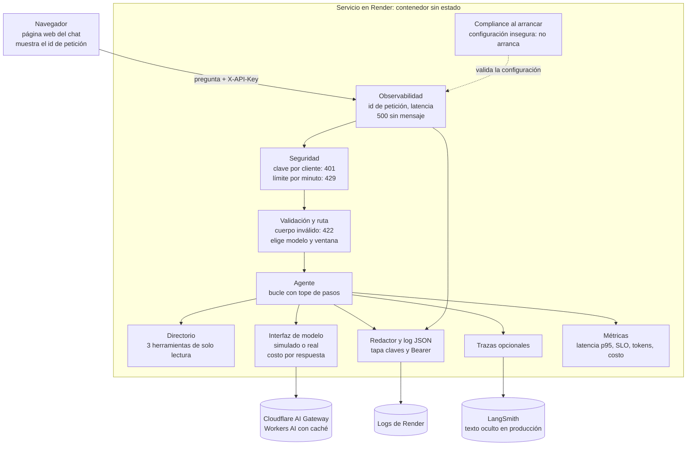
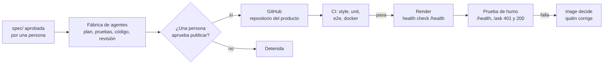

# Arquitectura del sistema

El HR Assistant es una API sin estado con un solo agente de IA que responde en español
preguntas sobre empleados. El agente usa herramientas de solo lectura sobre el directorio y
un modelo de lenguaje detrás de una interfaz intercambiable. Se publica como contenedor en
Render solo cuando una persona lo aprueba y el pipeline de CI pasa.

## Diagrama de arquitectura

### Publicación

## Flujo de comunicación entre componentes

Una pregunta recorre siete pasos, y cada uno puede cortar el recorrido con un error que
lleva el mismo id de petición.

1. **Arranque.** La configuración se lee del entorno. En producción, las reglas de
   compliance exigen el modelo real, claves de 16 caracteres o más, trazas que oculten el
   texto y que no esté el modo debug. Si algo falla, el servicio no arranca.
2. **Entrada.** La página web manda la pregunta, el historial y la clave del cliente. El
   middleware de observabilidad asigna un id de petición (o usa el que trae el cliente) y
   empieza a medir la latencia.
3. **Seguridad.** La autenticación compara la clave con las de los clientes (401 si no
   coincide) y el limitador cuenta las peticiones del cliente en el último minuto (429 si se
   pasa). Desde aquí solo viaja el nombre del cliente, nunca la clave.
4. **Validación.** El cuerpo se valida: pregunta no vacía y de largo máximo, historial con
   roles permitidos (422 si no cumple).
5. **Enrutamiento.** Una regla elige el modelo pequeño o el grande según la pregunta y
   recorta el historial a una ventana fija, para controlar el costo.
6. **Agente.** El agente conversa con el modelo en un bucle con tope de pasos. El modelo
   pide una herramienta de solo lectura del directorio (por id, departamento o nombre), el
   agente la ejecuta y le devuelve el resultado, hasta que el modelo da la respuesta. El
   modelo real se llama a través de Cloudflare AI Gateway, que agrega caché; si falla, la
   respuesta es 502.
7. **Salida.** La API devuelve la respuesta, los tokens, el costo y el id de petición. Cada
   evento pasa por el redactor central y queda como una línea JSON en el log, las métricas
   del proceso se actualizan y, si están encendidas, las trazas van a LangSmith con el id de
   petición.

Con el mismo id de petición se unen tres vistas de lo que pasó: la respuesta que vio la
persona, el log de Render y la traza de LangSmith.

## Decisiones arquitectónicas clave

Las decisiones priorizan seguridad y trazabilidad sobre funcionalidades extra. Cada una
tiene su ADR en [product/doc/adr/](../product/doc/adr/).

| Decisión | Por qué | Lo que se acepta a cambio |
| --- | --- | --- |
| API sin estado; el historial lo manda el cliente (ADR 0001) | Escala con varias copias sin base de datos ni sesiones | El cliente puede enviar un historial manipulado |
| Un solo agente con bucle con tope de pasos (ADR 0003) | Costo y latencia acotados; nunca queda en un ciclo infinito | Preguntas complejas pueden terminar sin respuesta |
| Herramientas de solo lectura sobre el directorio | El modelo no puede modificar datos aunque reciba instrucciones maliciosas | El asistente solo consulta, no ejecuta trámites |
| Modelo detrás de una interfaz, con un modelo simulado (ADR 0002, 0008) | Pruebas deterministas y CI sin red ni costo; cambiar de proveedor no toca el agente | El simulado no prueba la calidad del modelo real (eso lo mide la evaluación) |
| AI Gateway con enrutamiento, ventana, tope de salida y caché (ADR 0009, 0010) | El costo por respuesta bajó 86 % con la misma calidad ([costos](costos.md)) | Dependencia de un proveedor externo |
| Clave por cliente y límite de peticiones en memoria (ADR 0011, 0012) | Identifica quién pregunta y frena abusos sin infraestructura extra | El límite es por copia del servicio, no global |
| Compliance como código al arrancar (ADR 0013) | Una configuración insegura no llega a atender peticiones | Un error de configuración detiene el despliegue, a propósito |
| Id por petición, log JSON, métricas en memoria y trazas opcionales (ADR 0005 a 0007) | Responder con datos qué pasó con cualquier petición | Las métricas se pierden al reiniciar y no se suman entre copias |
| Redactor central y modo debug prohibido en producción (ADR 0014) | Ninguna credencial llega al log, ni en debug | En producción se depura solo con el id de petición y las trazas |
| Publicación con aprobación humana, CI y health check | Nada sale sin pasar pruebas y sin una persona que lo autorice | Publicar es más lento que un despliegue directo |
