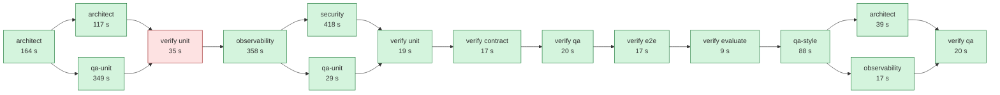

# Pipeline de la fábrica

| # | Paso | Resultado | Segundos |
| --- | --- | --- | --- |
| 1 | architect | pasó | 164 |
| 2 | architect | pasó | 117 |
| 3 | qa-unit | pasó | 349 |
| 4 | verify unit | falló | 35 |
| 5 | observability | pasó | 358 |
| 6 | security | pasó | 418 |
| 7 | qa-unit | pasó | 29 |
| 8 | verify unit | pasó | 19 |
| 9 | verify contract | pasó | 17 |
| 10 | verify qa | pasó | 20 |
| 11 | verify e2e | pasó | 17 |
| 12 | verify evaluate | pasó | 9 |
| 13 | qa-style | pasó | 88 |
| 14 | architect | pasó | 39 |
| 15 | observability | pasó | 17 |
| 16 | verify qa | pasó | 20 |
