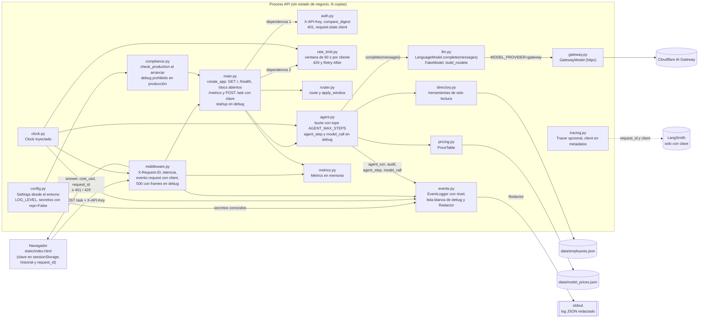
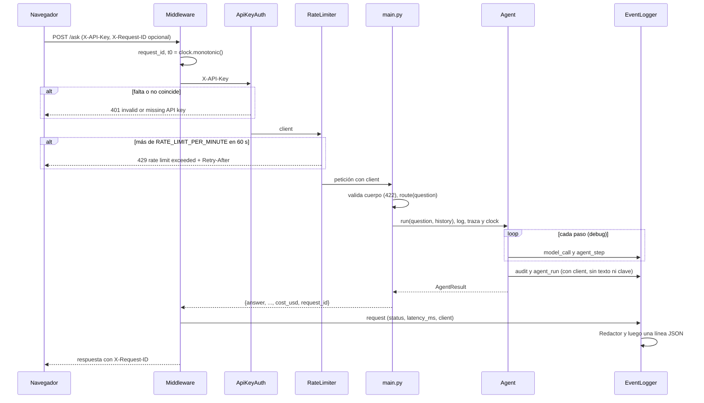

# Arquitectura del HR Assistant

Asistente de RH que responde preguntas sobre empleados desde una página web. API FastAPI
sin estado, un solo agente con bucle con tope y el modelo detrás de una interfaz. Desde la
sesión 2, cada petición lleva un `request_id`, deja eventos JSON en la salida estándar,
alimenta las métricas del proceso y, si se enciende, trazas en LangSmith. Desde la
sesión 3 hay un modelo real (Workers AI por AI Gateway) y cuatro palancas de costo:
enrutamiento por regla, ventana de historial, tope de salida y caché del gateway. Desde la
sesión 4, `/ask` y `/metrics` piden una clave por cliente y tienen límite de peticiones;
con `ENVIRONMENT=production` el producto se niega a arrancar si la configuración no cumple
las reglas de compliance. Se publica como contenedor en Render, solo si el CI pasa. Desde
la sesión 5, `LOG_LEVEL=debug` agrega eventos de diagnóstico, y todo evento pasa por un
redactor central antes de escribirse.

## Componentes



## Secuencia de una pregunta



El middleware es el más externo: también los `401` y `429` llevan `X-Request-ID`, su
evento `request` y cuentan en las métricas. La clave nunca sale de `auth.py`.

## Modo debug y redactor

- `LOG_LEVEL=info` (por omisión) da exactamente el log de la sesión 2.
- `LOG_LEVEL=debug` agrega `startup` (`request_id="-"`, con un campo `credentials`: lista de
  textos como `["API_KEYS=set", "CF_API_TOKEN=unset", "LANGSMITH_API_KEY=unset"]`),
  `agent_step`, `model_call` y `frames` en `error`. Solo campos de la lista blanca.
- El `Redactor` tapa por nombre de campo (solo claves de diccionario), por valor de secreto
  conocido y por `Bearer <algo>`, en todo evento y en todo nivel. No tiene excepciones por valor.
- `httpx` y `httpcore` se quedan en `WARNING`. LangSmith no cambia (`HIDE_INPUTS`,
  `HIDE_OUTPUTS`). Detalle en ADR 0014.

## Arranque y compliance

`load_settings` lee el entorno y `parse_api_keys` valida `API_KEYS` (el error dice el
número de entrada y su largo, nunca el valor). `create_app` llama `check_production`: con
`ENVIRONMENT=production` rechaza el modelo simulado, `API_KEYS` vacía, claves de menos de
16 caracteres, trazas encendidas sin `HIDE_INPUTS` y `HIDE_OUTPUTS`, y `LOG_LEVEL=debug`.
Cualquier `ConfigError` impide importar `app.main` y uvicorn no arranca. Detalle en
[compliance-checklist.md](compliance-checklist.md).

## Publicación

```mermaid
flowchart LR
    approve["Persona aprueba<br/>output/approved.txt"] --> push["publish.py<br/>repo en GitHub"]
    push --> style["CI: style<br/>pylint 88"]
    style --> unit["CI: unit<br/>cobertura 80 %"]
    unit --> e2e["CI: e2e<br/>Playwright, modelo simulado"]
    e2e --> docker["CI: docker<br/>docker build"]
    docker -- "checksPass" --> render["Render<br/>runtime docker, plan free<br/>healthCheckPath /health"]
    render --> smoke["smoke.py<br/>/health 200, /ask 401 y 200"]
```

- Imagen `python:3.12-slim`, usuario no root, puerto `${PORT:-8000}`.
- En Render: `ENVIRONMENT=production`, `MODEL_PROVIDER=gateway`, `HIDE_INPUTS=true`,
  `HIDE_OUTPUTS=true`. `API_KEYS`, `CF_ACCOUNT_ID` y `CF_API_TOKEN` con `sync: false`.
- El servicio se llama igual que el repositorio, para no pisar otro de la cuenta.

## Palancas de costo

| Palanca | Dónde | Variable |
| --- | --- | --- |
| Enrutamiento por regla | `router.route` | `ROUTING`, `ROUTER_MAX_CHARS` |
| Ventana de historial | `router.apply_window` | `HISTORY_WINDOW` |
| Tope de salida | `GatewayModel` | `MODEL_MAX_TOKENS` |
| Caché del gateway | `GatewayModel` | `CACHE_TTL_SECONDS` |

## Reglas del modelo simulado (en orden)

1. Último mensaje empieza con `Resultado de la herramienta: ` -> responde.
2. Id `EMP-` y cuatro dígitos -> `get_employee`.
3. Departamento existente -> `search_by_department`.
4. Nombre o apellido existente, palabra completa -> `search_by_name` (ADR 0004).
5. Si no -> texto de ayuda.

Hay dos instancias, con el nombre de `MODEL_SMALL` y `MODEL_LARGE`: responden igual y
su costo se calcula con el precio de su nombre (ADR 0010).

## Decisiones

- [ADR 0001: API sin estado](adr/0001-stateless-api.md)
- [ADR 0002: Interfaz de modelo y modelo simulado](adr/0002-model-interface-and-fake.md)
- [ADR 0003: Bucle con tope y protocolo JSON](adr/0003-bounded-agent-loop.md)
- [ADR 0004: Búsqueda por nombre](adr/0004-search-by-name.md)
- [ADR 0005: Id por petición y eventos JSON](adr/0005-request-id-and-json-events.md)
- [ADR 0006: Métricas en memoria de cada proceso](adr/0006-in-process-metrics.md)
- [ADR 0007: Trazas opcionales con LangSmith](adr/0007-optional-langsmith-tracing.md)
- [ADR 0008: Modelo real por AI Gateway detrás de la interfaz](adr/0008-gateway-model-behind-interface.md)
- [ADR 0009: Enrutamiento por regla y ventana de historial](adr/0009-rule-based-routing-and-history-window.md)
- [ADR 0010: Costo por respuesta con tabla de precios](adr/0010-cost-per-answer-from-price-table.md)
- [ADR 0011: Clave por cliente como dependencia de ruta](adr/0011-api-key-per-client.md)
- [ADR 0012: Límite de peticiones en memoria del proceso](adr/0012-in-process-rate-limit.md)
- [ADR 0013: Compliance al arrancar y publicación con compuertas](adr/0013-compliance-and-gated-release.md)
- [ADR 0014: Modo debug con lista blanca y redactor central](adr/0014-debug-mode-with-central-redactor.md)
